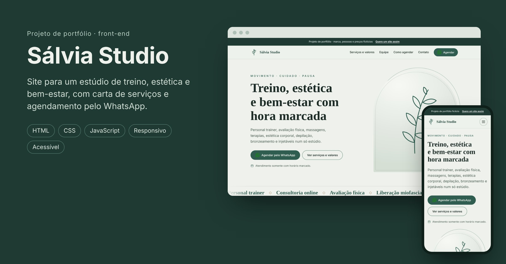
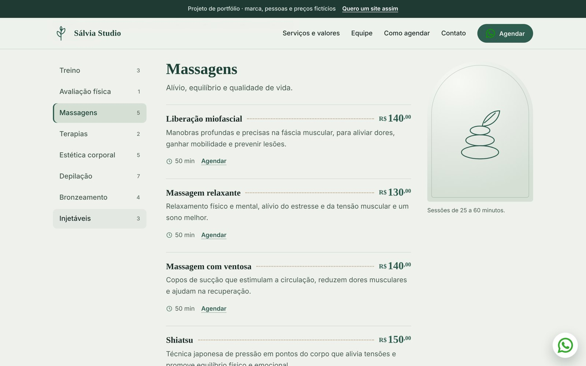
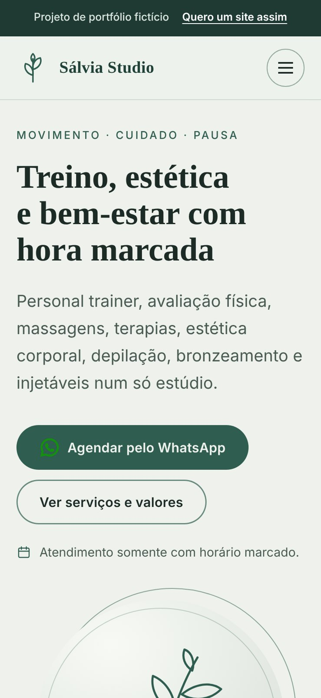

# Sálvia Studio

Site de uma página para um estúdio de treino, estética e bem-estar, feito com HTML, CSS e JavaScript puros, sem frameworks nem dependências.

> **Projeto de portfólio.** A marca, as pessoas, os preços e o endereço são fictícios.



**[Ver o site no ar](https://SEU-USUARIO.github.io/salvia-studio/)** · [Vídeo de demonstração](docs/salvia-studio.mp4)

## O que o site faz

- **Carta de serviços em abas.** Oito áreas (treino, avaliação física, massagens, terapias, estética, depilação, bronzeamento e injetáveis), cada uma com nome, descrição, duração e preço. As abas funcionam por clique, por teclado (setas, Home e End) e por link direto, como `#massagens`.
- **Agendamento pelo WhatsApp.** Cada serviço tem um botão que abre a conversa com o nome do serviço já escrito na mensagem.
- **Conversa simulada.** Na seção "Como agendar", a conversa fica presa na tela enquanto a página rola, e cada trecho de rolagem revela uma mensagem. Funciona com mouse, touchpad, dedo, teclado e barra de rolagem. O texto ao lado acompanha a conversa quando cabe na tela.
- **Animações com propósito.** Entrada do topo, letreiro de serviços, ilustrações que se revelam ao rolar e a linha pontilhada da carta que se desenha até o preço. Quem ativa "reduzir movimento" no aparelho vê tudo parado.
- **Pensado para o celular.** As áreas viram uma fileira deslizante, com uma barrinha que mostra a posição e indica que há mais áreas. Há também uma barra fixa de agendamento.

## Telas

| Carta de serviços | Celular |
|---|---|
|  |  |

## Acessibilidade

- Contraste mínimo de 4,5:1 em todos os textos, conferido nas oito abas, no celular e no computador.
- Áreas de toque com pelo menos 44 × 44 px.
- Abas com `role="tablist"`, `aria-selected` e navegação por setas; FAQ com `<details>`; link para pular para o conteúdo; foco visível em todos os elementos.
- Respeita `prefers-reduced-motion`.

## Estrutura

```
index.html        estrutura e textos
css/estilo.css    visual: tokens de cor, layout, animações
js/config.js      dados: WhatsApp, mensagens e a conversa de exemplo
js/script.js      comportamento: abas, barrinha, animações, menu e conversa
img/              ícones
docs/             imagens e vídeo deste README
```

Os dados ficam separados da lógica: para adaptar o site a outro negócio, basta editar `js/config.js` e os textos do `index.html`.

## Design

| Papel | Cor |
|---|---|
| Fundo (névoa de eucalipto) | `#EEF1EC` |
| Texto (verde-floresta) | `#1C2B26` |
| Botões e preços (eucalipto) | `#2F5D50` |
| Detalhes (latão) | `#8A5F2A` |
| Bloco de destaque | `#1F3A33` |

Tipografia: **Playfair Display** nos títulos e **Jost** no texto. As ilustrações são desenhadas em SVG, no próprio código.

## Como rodar

Não há instalação nem build: baixe o repositório e abra o `index.html` no navegador.

## Autor

[Seu nome] · [LinkedIn](https://www.linkedin.com/in/SEU-PERFIL)
